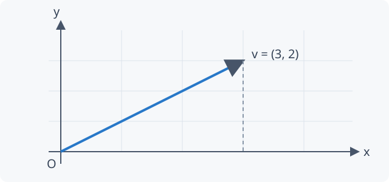

这是一份可直接复制到 Obsidian 的测试笔记，覆盖 Markdown、Obsidian 扩展与 MathJax 数学语法。可以编辑此文件来比较本地与网站效果。

## 快速导航

[[#Markdown 基础]] · [[#Obsidian 扩展]] · [[#LaTeX 数学]] · [[#组合测试]]

## Markdown 基础

### 标题层级

# 一级标题 H1
## 二级标题 H2
### 三级标题 H3
#### 四级标题 H4
##### 五级标题 H5
###### 六级标题 H6

Setext 二级标题
---------------

### 文本与段落

普通文字，**粗体**，*斜体*，***粗斜体***，~~删除线~~，==高亮==，**粗体中的 *斜体***。
这里使用单次换行，检查 Obsidian 风格的软换行。

这是空行分开的新段落。中文 English 123 混排：“引号”、（括号）、《书名》、——破折号。

转义：\*不是斜体\*、\#不是标题、\[不是链接\]、\$不是公式、反斜线 \\。

HTML 标签：H2O、x2、<kbd>Ctrl</kbd> + <kbd>S</kbd>。

---

### 列表、任务与引用

- 第一项
- 第二项含 **强调** 与 $a^2+b^2=c^2$
  - 二级项目
    - 三级项目
  - 二级项目

1. 第一项
2. 第二项
   1. 嵌套有序列表
   2. 另一个项目
3. 包含多个段落：

   这是项目内部的第二段。

   > 项目内引用，含 $\alpha+\beta$。

- [x] 已完成任务
- [ ] 待完成任务
  - [x] 已完成子任务
  - [ ] 子任务与 $f(x)$

> 一层引用。
>
> **引用中的粗体**与 $\nabla f$。
>
> > 二层引用。
> >
> > > 三层引用。

### 表格

| 左对齐 | 居中 | 右对齐 |
| :--- | :---: | ---: |
| **粗体** | *斜体* | 123.45 |
| 转义竖线 \| | $x_i^2$ | $1/2$ |
| [首页](/) | ==高亮== | -100 |

### 代码

行内代码：`const x = 1;`；包含反引号：`` `code` ``；`$x$` 与 `[[链接]]` 应保留原文。

~~~python
from math import sqrt

def norm(vector: list[float]) -> float:
    """中文注释：欧几里得范数。"""
    return sqrt(sum(x ** 2 for x in vector))

print(norm([3, 4]))  # 5.0
~~~

~~~javascript
const note = { title: "语法测试", formula: "$E=mc^2$" };
console.log(note.title, note.formula);
// [[这不是内部链接]]，%%这不是隐藏注释%%
~~~

~~~latex
\begin{aligned}
e^{i\pi}+1 &= 0 \\
\int_0^1x^2\,dx &= \frac13
\end{aligned}
~~~

~~~~markdown
## 源码示例
**粗体**、[[链接]]、$x^2$、%%注释%%
~~~python
print("嵌套代码围栏")
~~~
~~~~

    四空格缩进代码：
    $这里不应渲染为数学公式$

### 链接、脚注与图片

[返回目录](/) · [[Manifold/Smooth_Manifold_I|光滑流形]] · [引用式链接][home]

自动链接：<https://www.mathjax.org/>。

第一条脚注[^first]，含公式的脚注[^math]，再次引用[^first]。

[home]: / "网站首页"
[^first]: 脚注支持 **粗体**、*斜体* 和 [链接](/)。
[^math]: 脚注公式：$\sum_{k=1}^n k=n(n+1)/2$。

Obsidian 图片嵌入，指定宽度 320：

![[test-assets/coordinate.svg|320]]

点击展开原生 HTML 折叠内容

原生 HTML 内容：<strong>粗体</strong> 与 <code>inline code</code>。

## Obsidian 扩展

### 内部链接、标题与块引用

[[语法引用示例|按别名查找]] · [[test-assets/Reference#引用章节|标题链接]] · [[test-assets/Reference#^sample-block|段落块链接]]

这段有块 ID，通过 [[#^local-block|本页块链接]] 可以跳到这里。 ^local-block

### 嵌入完整笔记、章节、段落块

![[test-assets/Reference]]

![[test-assets/Reference#引用章节]]

![[test-assets/Reference#^sample-block]]

### Callout 与折叠

> [!note] 普通笔记
> **粗体**、*斜体*、==高亮== 与 $x\in\mathbb R$。

> [!tip] 提示
> 用于检查提示类样式。

> [!info] 信息
> 补充说明。

> [!warning] 警告
> 检查边框、背景、图标与正文。

> [!danger] 危险
> 检查强调色。

> [!success] 完成
> 完成测试示例。

> [!question] 问题
> 公式与折叠内容能否正常显示？

> [!example] 示例
> - 第一项
> - 第二项含 $\frac12$
>
> | 参数 | 值 |
> | --- | --- |
> | $n$ | $3$ |

> [!math] **定理 1** 二项式定理
> 对任意 **非负整数** $n$，有
>
> $$
> (a+b)^n=\sum_{k=0}^{n}\binom{n}{k}a^{n-k}b^k.
> $$

> [!note]+ 默认展开的折叠块
> 点击标题或用键盘聚焦后按 Enter。
>
> > [!tip]- 嵌套、默认折叠
> > 展开后可以看到 $e^{i\pi}+1=0$。

> [!warning]- 默认折叠的证明
> $$
> \begin{aligned}
> (a+b)^2 &=(a+b)(a+b)\\
> &=a^2+2ab+b^2.
> \end{aligned}
> $$

### 隐藏注释

这句话应该可见。%%SYNTAX_TEST_HIDDEN_INLINE%% 这句话也应该可见。

%%
SYNTAX_TEST_HIDDEN_BLOCK
此多行注释不应出现在正文中。
%%

## LaTeX 数学

使用美元符号包围行内或独立公式。本页测试 MathJax 数学排版；完整 LaTeX 文档、TikZ、外部宏包和 Dataview 等插件指令不属于这些语法。

### 行内、分式与根式

行内基线：$x$、$x_i$、$x^2$、$x_i^{n+1}$、$\frac ab$、$\sqrt x$、$\sum_{i=1}^n i$；公式后接中文。

$$
a+b-c,\quad a\cdot b,\quad a\times b,\quad a\div b,\quad
\pm x,\quad \mp y,\quad \frac{a+b}{c+d},\quad
\dfrac1{1+\frac1x},\quad \sqrt{x^2+y^2},\quad \sqrt[n]a
$$

### 希腊字母与字体

$$
\alpha,\beta,\gamma,\delta,\epsilon,\varepsilon,\zeta,\eta,\theta,\vartheta,
\iota,\kappa,\lambda,\mu,\nu,\xi,\pi,\varpi,\rho,\varrho,\sigma,\varsigma,\tau,\upsilon,\phi,\varphi,\chi,\psi,\omega
$$

$$
\Gamma,\Delta,\Theta,\Lambda,\Xi,\Pi,\Sigma,\Upsilon,\Phi,\Psi,\Omega
$$

$$
\mathrm{Roman}\quad\mathit{Italic}\quad\mathbf{Bold}\quad
\mathsf{Sans}\quad\mathtt{Mono}\quad\mathbb{RNCQZ}\quad
\mathcal{ABC}\quad\mathfrak{gsl}\quad\boldsymbol{\alpha+\beta}
$$

### 括号、重音与标注

$$
\left(\frac ab\right),\quad\left[\sum_{i=1}^nx_i\right],\quad
\left\{\frac xy\right\},\quad\langle u,v\rangle,\quad\lVert v\rVert,\quad
\left.\frac{df}{dx}\right|_{x=0}
$$

$$
\hat x,\ \widehat{ABC},\ \bar x,\ \overline{AB},\
\tilde x,\ \widetilde{xyz},\ \vec v,\ \overrightarrow{AB},\
\dot x,\ \ddot x,\ x',\ x'',\
\underbrace{a+\cdots+a}_{n\text{ terms}},\
\overbrace{x_1+\cdots+x_n}^{S_n}
$$

### 集合、逻辑与关系

$$
\mathbb N\subseteq\mathbb Z\subseteq\mathbb Q\subseteq\mathbb R\subseteq\mathbb C,\quad
A\cup B,\ A\cap B,\ A\setminus B,\ \varnothing
$$

$$
\forall x\in A,\ \exists y\notin B:\quad
x\neq y,\ x\leq y,\ x\geq y,\ x\ll z,\ x\sim y,\ x\approx y,\ x\equiv y,\ x\cong y
$$

$$
(P\land Q)\lor\neg R,\quad P\implies Q,\quad P\iff Q,\quad
A\triangle B,\quad\bigcup_{i\in I}U_i,\quad\bigcap_{n=1}^\infty F_n
$$

### 求和、乘积与组合

$$
\sum_{k=1}^nk=\frac{n(n+1)}2,\quad
\sum_{\substack{1\leq i,j\leq n\\i\neq j}}a_{ij},\quad
\prod_{k=1}^nk=n!,\quad\binom nk=\frac{n!}{k!(n-k)!}
$$

### 极限、微分与积分

$$
\lim_{x\to0}\frac{\sin x}{x}=1,\quad
\lim_{n\to\infty}\left(1+\frac1n\right)^n=e,\quad
\limsup_{n\to\infty}a_n,\quad\liminf_{n\to\infty}a_n
$$

$$
\frac d{dx}x^n=nx^{n-1},\quad
\frac{\partial^2f}{\partial x\,\partial y},\quad
\nabla f,\quad\nabla\cdot\mathbf F,\quad\nabla\times\mathbf F,\quad\Delta f
$$

$$
\int_0^1x^2\,dx=\frac13,\quad
\iint_Df(x,y)\,dx\,dy,\quad
\iiint_V\rho\,dV,\quad\oint_{\partial D}\omega
$$

### 函数与算子

$$
\sin^2x+\cos^2x=1,\quad\tan x=\frac{\sin x}{\cos x},\quad
\sinh x=\frac{e^x-e^{-x}}2,\quad
\log_a x=\frac{\ln x}{\ln a}
$$

$$
\exp z,\quad\arctan x,\quad\det A,\quad\ker T,\quad\dim V,\quad
\operatorname{rank}A,\quad\operatorname*{arg\,min}_{x\in X}f(x)
$$

### 矩阵与行列式

$$
\begin{matrix}a&b\\c&d\end{matrix}\quad
\begin{pmatrix}a&b\\c&d\end{pmatrix}\quad
\begin{bmatrix}a&b\\c&d\end{bmatrix}\quad
\begin{Bmatrix}a&b\\c&d\end{Bmatrix}\quad
\begin{vmatrix}a&b\\c&d\end{vmatrix}\quad
\begin{Vmatrix}a&b\\c&d\end{Vmatrix}
$$

$$
I_n=\begin{pmatrix}
1&0&\cdots&0\\0&1&\cdots&0\\
\vdots&\vdots&\ddots&\vdots\\0&0&\cdots&1
\end{pmatrix},\quad
\left[\begin{array}{cc|c}1&2&3\\0&1&4\end{array}\right]
$$

行内小矩阵 $\left(\begin{smallmatrix}1&0\\0&1\end{smallmatrix}\right)$ 不应破坏段落。

### 分段函数与多行对齐

$$
|x|=\begin{cases}x,&x\geq0,\\-x,&x<0.\end{cases}
$$

$$
\begin{aligned}
(x+y)^3&=(x+y)(x^2+2xy+y^2)\\
&=x^3+3x^2y+3xy^2+y^3.
\end{aligned}
$$

$$
\begin{gathered}
a^2+b^2=c^2\\e^{i\pi}+1=0\\
\int_{-\infty}^\infty e^{-x^2}\,dx=\sqrt\pi
\end{gathered}
$$

$$
\begin{alignedat}{2}
2x&+3y& &=7\\5x&-y& &=4
\end{alignedat}
$$

### 箭头与交换图

$$
A\xrightarrow fB\xleftarrow[g]{h}C,\quad
x\overset{\mathrm{def}}=y,\quad
a\underset{n\to\infty}{\longrightarrow}b,\quad
V\stackrel{\sim}{\longrightarrow}W
$$

$$
\begin{CD}
A @>f>> B\\
@VgVV @VVhV\\
C @>>k> D
\end{CD}
$$

### 数论、概率与几何

$$
a\equiv b\pmod n,\quad
\gcd(a,b)\operatorname{lcm}(a,b)=|ab|,\quad
p\mid ab\implies p\mid a\lor p\mid b
$$

$$
\mathbb P(A\mid B)=\frac{\mathbb P(A\cap B)}{\mathbb P(B)},\quad
\mathbb E[X]=\sum_xx\,p(x),\quad
\operatorname{Var}(X)=\mathbb E[X^2]-\mathbb E[X]^2
$$

$$
T_pM,\quad T_p^*M,\quad
\omega=\sum_{i<j}\omega_{ij}\,dx^i\wedge dx^j,\quad
d^2=0,\quad\int_Md\omega=\int_{\partial M}\omega
$$

### 颜色、间距与自定义宏

$$
{\color{blue}x^2}+{\color{red}y^2}={\color{green}z^2},\quad
\boxed{E=mc^2},\quad\cancel{x}+y
$$

$$
a\,b\;c\quad d\qquad e,\quad
\text{for all }x\in\mathbb R,\quad\text{若 }x>0,\ \log x\in\mathbb R
$$

$$
{\def\RR{\mathbb R}\def\norm#1{\left\lVert#1\right\rVert}
f:\RR^n\to\RR,\quad\norm{x}=\sqrt{\sum_{i=1}^nx_i^2}}
$$

## 组合测试

### 长公式与窄屏

故意使用长公式，检查公式区域横向滚动与手机页面宽度：

$$
\left(\sum_{i=1}^na_ib_i\right)^2
\leq\left(\sum_{i=1}^na_i^2\right)\left(\sum_{i=1}^nb_i^2\right)
=\left(a_1^2+a_2^2+\cdots+a_n^2\right)\left(b_1^2+b_2^2+\cdots+b_n^2\right).
$$

**结论 $f'(x)=2x$**，*假设 $x>0$*，==结果 $\int_0^1x\,dx=1/2$==，~~旧值 $x=0$~~。

> [!math]+ **命题 2** 列表与证明
> 设 $A\in M_2(\mathbb R)$。
>
> 1. 若 $\det A\neq0$，则 $A$ 可逆。
> 2. 若 $\det A=0$，则 $\operatorname{rank}A<2$。
>
> $$
> A^{-1}=\frac1{ad-bc}\begin{pmatrix}d&-b\\-c&a\end{pmatrix}.
> $$
>
> > [!note]- 展开检查补充说明
> > 这里的公式 $\det A=ad-bc$ 应正常显示。

测试结束。[[index|返回笔记目录]]
